# DER inicial y notas de diseño — Mnemosine

Fecha: 16 de noviembre de 2026. Estado: propuesta de arranque (Fase 0); las
migraciones en `database/migrations/` son la definición ejecutable. Esquema
derivado del SRS (14 entidades) + extensiones propuestas (USER_SESSION,
PERMISSION_AUDIT, INVITATION). USER_PREFERENCE se reserva.

## Diagrama (Mermaid)

```mermaid
erDiagram
    USER_ACCOUNT ||--o{ USER_SESSION : "tiene"
    USER_ACCOUNT ||--o{ INVITATION : "genera"
    USER_ACCOUNT ||--o{ TRACK_LOCATION : "posee"
    USER_ACCOUNT ||--o{ TRACK_SHARE : "recibe"
    USER_ACCOUNT ||--o{ PLAYLIST : "posee"
    USER_ACCOUNT ||--o{ SCAN_JOB : "solicita"
    USER_ACCOUNT ||--o{ FILE_OPERATION : "origina"
    DEVICE ||--o{ SOURCE : "aloja"
    SOURCE ||--o{ SCAN_JOB : "origina"
    SOURCE ||--o{ TRACK_LOCATION : "contiene"
    TRACK ||--o{ TRACK_LOCATION : "se copia en"
    TRACK }o--|| ALBUM : "pertenece a"
    TRACK ||--o{ TRACK_ARTIST : ""
    ARTIST ||--o{ TRACK_ARTIST : ""
    ALBUM ||--o{ ALBUM_ARTIST : ""
    ARTIST ||--o{ ALBUM_ARTIST : ""
    TRACK_LOCATION ||--o{ TRACK_SHARE : "se comparte en"
    TRACK_LOCATION ||--o{ FILE_OPERATION : ""
    TRACK_LOCATION ||--o{ PERMISSION_AUDIT : ""
    PLAYLIST ||--|{ PLAYLIST_TRACK : "ordena"
    TRACK ||--o{ PLAYLIST_TRACK : "aparece en"

    USER_ACCOUNT {
        bigint user_id PK
        varchar username UK
        varchar email UK
        varchar password_hash
        enum role "USER|ADMIN"
        tinyint is_active
        datetime created_at
        datetime updated_at
    }
    USER_SESSION {
        bigint session_id PK
        bigint user_id FK
        char token_hash UK
        datetime created_at
        datetime expires_at
        datetime last_used_at
        datetime revoked_at
    }
    INVITATION {
        bigint invitation_id PK
        char code_hash UK
        bigint created_by FK
        bigint used_by FK "NULL"
        datetime created_at
        datetime expires_at
        datetime used_at "NULL"
    }
    DEVICE {
        bigint device_id PK
        varchar name
        enum kind "SERVER|LOCAL|CLOUD"
        datetime created_at
    }
    SOURCE {
        bigint source_id PK
        bigint device_id FK
        bigint owner_user_id FK "NULL"
        varchar name
        varchar base_relative_path
        enum status "ACTIVE|DISCONNECTED"
        datetime last_scanned_at "NULL"
        datetime created_at
    }
    SCAN_JOB {
        bigint scan_job_id PK
        bigint source_id FK
        bigint owner_user_id FK "NOT NULL"
        enum status "PENDING|RUNNING|COMPLETED|FAILED|CANCELLED"
        int files_found
        int files_added
        int files_skipped
        varchar error_message "NULL"
        datetime created_at
        datetime started_at "NULL"
        datetime finished_at "NULL"
    }
    ARTIST {
        bigint artist_id PK
        varchar name
        varchar sort_name "NULL"
        datetime created_at
    }
    ALBUM {
        bigint album_id PK
        varchar title
        varchar sort_title "NULL"
        smallint release_year "NULL"
        datetime created_at
    }
    TRACK {
        bigint track_id PK
        varchar title
        varchar sort_title "NULL"
        int duration_seconds
        tinyint disc_number "NULL"
        tinyint track_number "NULL"
        bigint album_id FK "NULL"
        datetime created_at
        datetime updated_at
    }
    TRACK_ARTIST {
        bigint track_id PK,FK
        bigint artist_id PK,FK
        tinyint position
        enum role "MAIN|FEATURING"
    }
    ALBUM_ARTIST {
        bigint album_id PK,FK
        bigint artist_id PK,FK
    }
    TRACK_LOCATION {
        bigint location_id PK
        bigint track_id FK
        bigint owner_user_id FK "NOT NULL"
        bigint source_id FK "NOT NULL"
        varchar relative_path "<=512"
        char sha256 "sin unicidad global"
        bigint size_bytes
        varchar mime_type
        enum visibility "PRIVATE|PUBLIC"
        enum availability "AVAILABLE|MISSING|ERROR"
        datetime created_at
        datetime updated_at
    }
    TRACK_SHARE {
        bigint share_id PK
        bigint location_id FK
        bigint recipient_user_id FK
        tinyint can_stream
        tinyint can_download
        bigint granted_by FK
        varchar declaration "texto declarado"
        datetime granted_at
        datetime revoked_at "NULL"
        bigint revoked_by FK "NULL"
    }
    PLAYLIST {
        bigint playlist_id PK
        bigint owner_user_id FK
        varchar name
        varchar description "NULL"
        datetime created_at
        datetime updated_at
    }
    PLAYLIST_TRACK {
        bigint playlist_id PK,FK
        bigint track_id PK,FK
        int position
    }
    FILE_OPERATION {
        bigint operation_id PK
        enum type "UPLOAD|DOWNLOAD|SCAN"
        bigint actor_user_id FK "NULL, SET NULL"
        bigint location_id FK "NULL, SET NULL"
        enum result "SUCCESS|FAILURE"
        bigint bytes_transferred "NULL"
        varchar detail "sin rutas sensibles"
        datetime created_at
    }
    PERMISSION_AUDIT {
        bigint audit_id PK
        bigint actor_user_id FK "NULL, SET NULL"
        enum action
        bigint location_id FK "NULL, SET NULL"
        bigint target_user_id FK "NULL, SET NULL"
        varchar declaration "NULL"
        varchar details "NULL, sin secretos"
        datetime created_at
    }
```

`PERMISSION_AUDIT.action` ∈ `PUBLISH | UNPUBLISH | SHARE_GRANT | SHARE_REVOKE |
DOWNLOAD_GRANT | DOWNLOAD_REVOKE | VISIBILITY_CHANGE | ROLE_CHANGE |
ACCOUNT_DEACTIVATE | ACCOUNT_ACTIVATE`.

## Notas de diseño

1. **Charset/collation**: InnoDB + `utf8mb4_0900_ai_ci` (coherente con
   `compose.yaml`). Sin índices de prefijo que relajen unicidad en silencio.
2. **UNIQUE(source_id, relative_path)** con `relative_path VARCHAR(512)`:
   512 × 4 B (utf8mb4) + 8 B de `source_id` < 3072 B del límite de índice
   InnoDB. **El servidor rechaza rutas relativas normalizadas de más de 512
   caracteres** en carga y escaneo (no se trunca).
3. **Rutas**: siempre relativas a la raíz de la fuente o al almacenamiento
   local, normalizadas (`/`, sin `..`, sin enlaces fuera de la raíz). Las
   absolutas y los escapes se rechazan en validación.
4. **SHA-256 sin unicidad global**: identifica bytes, no grabaciones ni
   licencia. Índice normal (no único) en `sha256` para detección de
   duplicados; cada copia conserva dueño y permisos independientes.
5. **TRACK_SHARE**: una fila por (copia, destinatario) — `UNIQUE(location_id,
   recipient_user_id)`; re-conceder tras revocar actualiza la fila
   (`revoked_at NULL`, nuevos flags). `declaration` registra la declaración de
   autorización (quién/cuándo/alcance en texto).
6. **PLAYLIST_TRACK**: `PK(playlist_id, track_id)` (la canción aparece una vez
   por lista, SRS) + `UNIQUE(playlist_id, position)`. Reordenar dentro de una
   transacción con posiciones temporales negativas o re-numeración para no
   violar la unicidad intermedia.
7. **Deshacer acciones**: FKs `CASCADE` solo en asociaciones
   (TRACK_ARTIST, ALBUM_ARTIST, PLAYLIST_TRACK, USER_SESSION); `RESTRICT` en
   recursos con dependencias (TRACK_LOCATION→SOURCE/USER); `SET NULL` en
   referencias históricas opcionales (FILE_OPERATION, PERMISSION_AUDIT).
8. **Eliminar registros no borra audio**. No hay borrado físico implícito en
   el MVP; la columna `availability` permite retirar del catálogo sin borrar
   (`MISSING`/`ERROR`) conservando la referencia de bibliotecas y listas.
9. **Índices** previstos para filtros frecuentes:
   `TRACK_LOCATION(owner_user_id, visibility)`, `(sha256)`, `(source_id)`,
   `TRACK_SHARE(recipient_user_id)`, `(location_id)`,
   `PLAYLIST(owner_user_id)`, `PLAYLIST_TRACK(track_id)`,
   `FILE_OPERATION(type, created_at)`, `PERMISSION_AUDIT(location_id)`,
   `USER_SESSION(token_hash)` (UNIQUE ya lo indexa), `expires_at`.
   Búsqueda por título/artista/álbum: `INDEX(TRACK.title)`,
   `INDEX(ARTIST.name)`, `INDEX(ALBUM.title)`; medir con 10 000 canciones
   antes de añadir FULLTEXT o motores externos.
10. **TRACK compartido entre cuentas**: metadatos corregidos vía moderación
    administrada; ningún propietario edita libremente un TRACK usado por
    varias cuentas (decisión del plan maestro §3, M4). Se registra en
    PERMISSION_AUDIT o en futuras anotaciones de catálogo.
11. **USER_SESSION** soporta revocación en caliente: el middleware comprueba
    `revoked_at IS NULL AND expires_at > NOW()` en cada request; desactivar
    la cuenta revoca todas sus sesiones.
