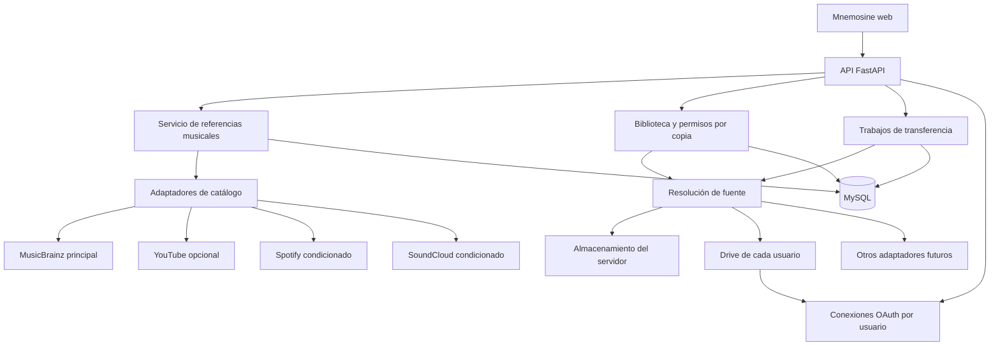

# Plan de integración de catálogos musicales y almacenamiento

Fecha: 24 de noviembre de 2026. Actualización: 27 de noviembre de 2026.

Mnemosine incorporará consultas de música en servicios externos y almacenamiento de archivos en distintos medios. **Cada usuario conectará su propia cuenta de Google Drive**, decisión confirmada para este plan. El servidor seguirá disponible como destino de cargas y origen de archivos.

La entrega integrada propuesta combina servidor + Drive personal + búsqueda e indexación de nombres mediante **MusicBrainz como proveedor principal de metadatos**. El almacenamiento queda modular para incorporar otras fuentes mediante adaptadores; no se añade otro medio real en esta etapa.

**Ejecución iniciada el 25/11/2026:** primera entrega con preparación I0, bases de I1 e índice I5. El estado implementado, las verificaciones y lo pendiente están en [INTEGRACIONES.md](INTEGRACIONES.md). Este plan conserva el alcance completo: Drive y la entrega integrada todavía no están completados. Contacto MusicBrainz confirmado por el usuario: `czmprojects@gmail.com`. El 27/11/2026 se configuró el proyecto Google `mnemosine-516014` con `drive.file` y Picker restringido, y se implementó I2: OAuth por usuario, cifrado, reconexión/desconexión y selección privada comprobada por ID. Las pruebas automáticas pasan; falta la aceptación real con las dos cuentas. La selección aún no valida bytes ni crea copias reproducibles: eso sigue en I3/I4. Véase [GOOGLE_DRIVE_CONFIGURACION.md](GOOGLE_DRIVE_CONFIGURACION.md).

## 1. Alcance y acciones del usuario

| Función | Resultado esperado |
|---|---|
| Consultar un servicio musical | Ver resultados, canciones o videos musicales, álbumes y listas según lo que ofrezca su API; mostrar proveedor y enlace original |
| Indexar nombres con MusicBrainz | Buscar por título y artista; conservar los campos básicos permitidos y el identificador de la grabación para consultas posteriores |
| Guardar una referencia musical | Conservar un enlace y los metadatos permitidos en una colección privada de Mnemosine |
| Conectar mi Drive | Autorizar el acceso a los archivos elegidos y a los creados por Mnemosine |
| Subir desde el equipo | Elegir destino: servidor o mi Drive; validar el audio y crear una copia privada |
| Vincular un archivo de Drive | Incorporar una copia remota a la biblioteca; el archivo permanece en Drive |
| Copiar de Drive al servidor | Crear una copia local validada, conservando el original de Drive |
| Copiar del servidor a Drive | Crear una copia remota validada, conservando el original del servidor |
| Descargar un archivo | Recuperar sus bytes desde el medio correspondiente, comprobando permisos |
| Incorporar otro medio | Añadir un adaptador, su configuración y sus pruebas sin rehacer biblioteca o permisos |

“Extraer” se interpreta aquí como leer, descargar o copiar archivos desde un medio autorizado como Drive. Los conectores musicales solo consultan listados y referencias: no descargan audio, no usan reproductores externos y no modifican listas del proveedor. Encontrar un nombre en MusicBrainz o en otro catálogo no crea un archivo ni acredita que Mnemosine disponga de esa música.

La primera iteración mantiene los formatos de audio actuales: MP3, M4A/AAC, FLAC, OGG Vorbis y WAV. Otros tipos de medios, como video o imágenes, requerirán validación y una experiencia específica posterior. La extensibilidad de almacenamiento no significa que el reproductor ya los admita.

También quedan para después: sincronización bidireccional automática, movimientos que borren el original, exploración completa de todos los archivos de Drive, unidades compartidas de Google Workspace, correspondencias automáticas entre referencias externas y audio interno, y conectores reales de S3/R2, OneDrive, Dropbox o NAS.

Esta ampliación desarrolla RF-14 y la parte de consulta de RF-22/RF-23 del SRS. La publicación de referencias y RF-24/RF-25 quedan fuera de esta entrega centrada en enlistación. La escritura en Drive, excluida del MVP original, pasa a ser alcance explícito de esta etapa.

## 2. Punto de partida comprobado en el repositorio

Ya existen cuentas, sesiones, biblioteca, cargas, reproducción, compartición, listas, escaneos y un adaptador local. Hay migraciones hasta `0013_informe_escaneo.sql`. El documento de verificación registra pruebas de las fases H1–H6; este plan no sustituye su ejecución ni cierra sus pendientes visuales.

| Pieza actual | Cambio necesario para integrar otros medios |
|---|---|
| `backend/app/services/storage.py` | `get_storage()` devuelve una única instancia local. Agregar resolución por `source_id` y conexión autorizada |
| `backend/app/storage/contract.py` | El contrato supone rutas y publicación atómica local. Separar preparación local, objetos remotos y capacidades de cada medio |
| `backend/app/services/uploads.py` | El destino está fijado a la fuente central 9001 y la validación usa un temporal local. Permitir destino explícito sin perder esa validación |
| `backend/app/services/copies.py` | Las copias se verifican en el almacenamiento único. Consultar su fuente y distinguir desconexión, falta de permisos y archivo ausente |
| `backend/app/api/tracks.py` | Audio y descarga reutilizan `get_storage()`; la carga lee hasta el límite completo en memoria. Pasar a procesamiento acotado por bloques y entrega por fuente |
| `backend/app/services/scans.py` | Recorre directorios locales. Mantener ese escaneo e incorporar inventario remoto paginado por separado |
| `SOURCE` y `TRACK_LOCATION` | No existe todavía un discriminador de proveedor ni una referencia OAuth; `relative_path` no representa un ID de Drive |
| `FILE_OPERATION` | Solo registra UPLOAD/DOWNLOAD/SCAN y resultado final. Las transferencias remotas necesitan estado duradero y reintentos |

La migración 0012 ya dejó las rutas locales relativas a la raíz global, con el prefijo de la fuente. **No se debe volver a agregar ese prefijo ni reinterpretar las rutas existentes como relativas a cada fuente.**

Parte del README y de la arquitectura todavía describe el esqueleto inicial. Al implementar I0 se actualizará ese estado usando el código y las verificaciones reproducibles como referencia.

## 3. Servicios musicales y viabilidad

MusicBrainz se incorpora por la ampliación del 25 de noviembre y pasa a ser la primera integración de catálogo. YouTube, Spotify y SoundCloud proceden del SRS y quedan como ampliaciones opcionales. Deezer se evaluó y se descarta para el índice local bajo sus condiciones estándar actuales. Cada proveedor se habilita por configuración y capacidades comprobadas; la biblioteca propia no depende de su disponibilidad.

| Proveedor | Primera función propuesta | Acceso y condicionantes |
|---|---|---|
| MusicBrainz — principal | Buscar nombres, artistas, grabaciones y ediciones; construir un índice de metadatos básicos | Consultas públicas sin cuenta del usuario ni API key; identificar la app y limitar las peticiones. Solo indexar campos cuya licencia permita conservarlos |
| Deezer — descartado para esta etapa | No implementar su conector ni persistir su catálogo | Aprobación selectiva y restricciones de copia/base separada incompatibles con el índice propuesto, salvo acuerdo específico |
| YouTube Data API — opcional | Consultar una lista por enlace/ID y mostrar sus elementos; búsqueda pública posterior | Clave de proyecto para datos públicos; OAuth de lectura para recursos privados. El producto se presenta como integración de YouTube, sin prometer cobertura completa de YouTube Music |
| Spotify Web API | Consultar referencias y listas accesibles a la cuenta autorizada | Piloto condicionado a credenciales, modo de acceso y compatibilidad de políticas; no se promete acceso general a cualquier lista |
| SoundCloud API | Buscar metadatos y resolver enlaces; listas cuando estén disponibles para la aplicación | Credenciales de aplicación; conexión de usuario solo si se habilitan recursos privados |

**MusicBrainz: incorporar.** Su API permite buscar y consultar entidades musicales públicas sin API key; admite JSON y el uso no comercial del servicio es gratuito. Para un uso comercial se revisan los planes del servicio, diferenciándolos de la licencia de sus datos. [API oficial](https://musicbrainz.org/doc/MusicBrainz_API).

El índice inicial incluirá título, crédito de artistas, duración, ISRC cuando exista, MBID y datos básicos de edición. Esos campos pertenecen al núcleo de datos; este se publica bajo CC0, mientras que los datos suplementarios tienen otra licencia. No almacenar por defecto respuestas completas, anotaciones, etiquetas, valoraciones o portadas. [Campos del núcleo](https://musicbrainz.org/doc/MusicBrainz_Database), [licencias](https://musicbrainz.org/doc/About/Data_License).

El servicio público exige identificación de la aplicación y limita las solicitudes aproximadamente a una por segundo por IP. Mnemosine tendrá un limitador compartido entre todos sus usuarios y procesos, caché y espera ante errores; no un límite independiente por usuario. [Límites y User-Agent](https://musicbrainz.org/doc/MusicBrainz_API/Rate_Limiting).

**Deezer: descartar para este alcance.** Sus términos actualizados el 27 de octubre de 2026 exigen aprobación del desarrollador; la sección III.4 restringe extraer contenido para crear una base separada o guardar copias locales. La definición de contenido incluye metadatos. Mi evaluación es que no encaja con un índice persistente propio bajo esas condiciones, salvo acuerdo escrito distinto. Esto no afirma que toda consulta pública sea técnicamente imposible. No se incluye trabajo ni tiempo de implementación de Deezer. [Condiciones oficiales, secciones I, II y III.4](https://developers.deezer.com/termsofuse).

**YouTube, ampliación opcional:** `playlists.list` y `playlistItems.list` permiten consultar listas y sus elementos con paginación. Si se incorpora, comenzar por una lista introducida por el usuario. No interpretar automáticamente el nombre del canal como artista ni el título del video como metadatos musicales normalizados. [Listas](https://developers.google.com/youtube/data/reference/rest/v3/playlists/list), [elementos de listas](https://developers.google.com/youtube/data/reference/rest/v3/playlistItems/list).

La documentación consultada separa la cuota de búsqueda de la de otros métodos. Se registrará la cuota efectiva del proyecto y se limitarán las llamadas; no se copiarán valores de tutoriales antiguos. [Cuotas de YouTube](https://developers.google.com/youtube/data/getting-started).

**Spotify:** el modo de desarrollo requiere Premium para el titular de la app y permite hasta cinco usuarios autenticados autorizados para una nueva integración. La ampliación de acceso tiene requisitos independientes y no se presupone disponible para este proyecto. [Modos de cuota](https://developer.spotify.com/documentation/web-api/concepts/quota-modes).

En ese modo, el contenido de listas se limita a listas propias o en las que el usuario colabora; las rutas actuales usan `/playlists/{id}/items`, y la búsqueda tiene paginación reducida. [Guía de cambios de Spotify](https://developer.spotify.com/documentation/web-api/tutorials/february-2026-migration-guide).

Además, Spotify exige atribución y enlaces, y restringe productos que integren contenido de otros servicios. **Implicación para Mnemosine:** comprobar el encaje de este caso de uso antes de habilitarlo; separar pantallas por sí solo no demuestra cumplimiento. Si el encaje no está claro, mantener el conector deshabilitado y solicitar aclaración al proveedor. No hacer depender la entrega de Drive de esa resolución. [Política de Spotify](https://developer.spotify.com/policy).

**SoundCloud:** el registro de una aplicación requiere actualmente Artist Pro. Su guía permite credenciales de aplicación para recursos públicos y exige PKCE en el flujo de autorización de usuario. La implementación queda condicionada a disponer de las credenciales; no supone contratar una suscripción. [Registro de aplicaciones](https://developers.soundcloud.com/docs/api/register-app), [autenticación y búsqueda](https://developers.soundcloud.com/docs/api/guide).

## 4. Arquitectura extensible



Se conservan Vue, FastAPI y MySQL con SQL parametrizado. Un trabajador supervisado ejecutará transferencias persistidas en MySQL. No hace falta introducir microservicios ni una cola adicional para la primera entrega.

### 4.1 Contrato para listados musicales

`MusicCatalogAdapter` ofrecerá capacidades como `search`, `get_reference`, `list_playlists`, `list_playlist_items` y `resolve_provider_url`. Cada adaptador declara qué soporta y qué autenticación necesita. Una operación no soportada devuelve un estado claro, no una lista vacía engañosa.

La respuesta normalizada incluirá proveedor, tipo de recurso, ID externo, título, creador/artistas cuando existan, álbum si existe, duración opcional, imagen autorizada, URL original, fecha de consulta y cursor opaco de la siguiente página. Los campos ausentes permanecen vacíos; no se inventan ISRC, álbum ni artistas. El modelo común es interno: los resultados se presentan por proveedor, conservando su atribución y las condiciones de uso de cada catálogo.

El contrato no tendrá métodos para obtener audio, cargar archivos o editar listas del proveedor. Las referencias guardadas no se insertan como TRACK_LOCATION ni activan controles de reproducción o descarga.

### 4.1.1 Búsqueda e índice inicial de MusicBrainz

Propuesta de implementación:

1. Buscar grabaciones por nombre y, opcionalmente, artista mediante `/ws/2/recording` con `query`, `fmt=json`, `limit` y `offset`. Construir consultas literales escapando la sintaxis de búsqueda y codificando los parámetros; no concatenar texto libre sin validación. [Búsqueda oficial](https://musicbrainz.org/doc/MusicBrainz_API/Search).
2. Consultar primero el índice local; cuando falten resultados, el usuario puede ampliar la consulta a MusicBrainz. Mostrar procedencia y fecha de consulta. Refrescar a petición o por caducidad al utilizar el registro, sin barridos periódicos del catálogo remoto.
3. Guardar únicamente la lista blanca de campos del núcleo. Usar `(provider, entity_type, provider_id)` como identidad; para una grabación de MusicBrainz, `provider_id` será su MBID. Normalizar texto solo en los campos destinados a búsqueda, conservando la escritura original.
4. Distinguir grabación, edición y posición de pista. Una grabación puede aparecer en varias ediciones; no asignar un único álbum por defecto ni fusionar actuaciones en vivo, remixes o versiones solo por el título. [Modelo de grabaciones](https://musicbrainz.org/doc/Recording).
5. Guardar una referencia elegida por el usuario en su colección privada, separada del índice público. No modificar automáticamente el TRACK local, sus etiquetas ni sus permisos. Vincularla a un archivo requerirá una acción posterior y queda fuera de este primer índice.
6. Permitir búsquedas sin resultados y metadatos incompletos. La puntuación del buscador no es una certeza de identidad ni un dato que deba conservarse como parte del núcleo.

Primera entrega: índice progresivo de registros consultados/seleccionados, sin recorrer toda la API para copiar el catálogo mundial. Si el volumen futuro exige un catálogo completo, planificar por separado la importación de los volcados oficiales del núcleo, con su licencia y capacidad de almacenamiento. [Descargas oficiales](https://musicbrainz.org/doc/MusicBrainz_Database/Download).

La implementación del proveedor declarará `search=true`, `lookup=true`, `requires_user_connection=false` y `playlists=false` para este alcance. La interfaz no mostrará un botón de conectar MusicBrainz ni funciones de listas del proveedor que no se implementen. La búsqueda usará el backend para aplicar una política de tráfico común.

### 4.2 Contrato para almacenamiento

`StorageAdapter` evoluciona a operaciones sobre identificadores de objeto: `stat`, `list_objects`, `read_range`, `upload`, `get_upload_status`, `abort_upload` y borrado explícito de objetos creados por una operación propia. `StorageCapabilities` describirá lectura, escritura, rangos, subida reanudable, listado y seguimiento de cambios.

- LOCAL conserva rutas relativas normalizadas y una raíz administrada. Un usuario no puede escoger una ruta arbitraria del servidor.
- GOOGLE_DRIVE usa `fileId` y `folderId`; un nombre de archivo no identifica de forma única un objeto.
- La validación de audio se hace en un temporal privado del servidor, incluso si el destino final es remoto. El temporal no es una copia permanente de la biblioteca.
- No se promete `rename` ni `commit` atómico distribuido. La disponibilidad en Mnemosine se publica después de verificar objeto y registro; un trabajo pendiente permite reconciliar fallos.
- Los adaptadores se crean con la fuente y la conexión correctas. No se reutiliza un cliente con credenciales de un usuario para otro por una caché global.
- Antes de llamar al adaptador, el servicio verifica sesión, cuenta activa, copia, acción y fuente; antes de una transferencia larga, vuelve a comprobarlos al ejecutarla y al finalizarla.
- `stat` distingue FOUND, NOT_ACCESSIBLE, NOT_FOUND, AUTH_REQUIRED, RATE_LIMITED y TEMPORARY_ERROR. Un 403/404 remoto puede ocultar falta de acceso; no se deduce borrado físico sin evidencia.

Para añadir otro medio se implementará su adaptador, se registrarán sus capacidades y configuración, se definirá el tipo de credencial si lo necesita y se superarán las mismas pruebas de contrato. R2/S3, OneDrive, Dropbox y volúmenes montados quedan como extensiones posibles, no como funcionalidades ya entregadas.

### 4.3 Regla de modularidad para nuevas fuentes

Habrá dos registros independientes: `MusicCatalogRegistry` para nombres/metadatos y `StorageRegistry` para archivos. MusicBrainz pertenece al primero; Drive y LOCAL al segundo. Agregar un catálogo no da acceso a bytes, y agregar almacenamiento no cambia la identidad musical.

Cada módulo declara un código estable, su fábrica, capacidades y esquema de configuración. Las operaciones de la aplicación resuelven el módulo mediante la fuente; las particularidades de Drive, rutas locales o credenciales permanecen dentro del adaptador. Las reglas de sesión, propiedad, autorización, cuota y auditoría permanecen en servicios comunes.

Estructura propuesta, sin crear todavía módulos adicionales:

```text
backend/app/integrations/catalog/
  contract.py
  registry.py
  providers/musicbrainz.py
backend/app/storage/
  contract.py
  registry.py
  local.py
  google_drive.py
```

- Admitir fuentes de solo lectura: no todos los módulos tienen que soportar escritura, borrado o subida reanudable. Rechazar una acción no soportada antes de transferir bytes.
- Guardar el código del proveedor y su configuración versionada; no dispersar listas cerradas de proveedores en las rutas y servicios. Añadir un módulo no debería exigir cambiar el esquema solo para agregar un valor a un ENUM.
- Registrar módulos incluidos en el despliegue, sin cargar código arbitrario aportado por usuarios ni construir un mercado de plugins.
- Las credenciales van en conexiones protegidas, no en la configuración pública de SOURCE. LOCAL funciona sin OAuth.
- Validar la extensibilidad con un adaptador de prueba de solo lectura. Debe permitir listar y leer a través del mismo servicio sin editar biblioteca, reproductor o permisos. No hace falta integrar un tercer servicio real para demostrarlo.

**Alcance de almacenamiento conservado:** servidor y Drive personal primero; las otras fuentes quedan abiertas mediante este contrato, sin añadir ahora sincronización general ni nuevos conectores.

## 5. Drive personal y permisos

### 5.1 Alcance de acceso inicial

Usar OAuth por usuario con `drive.file` y Google Picker para elegir archivos. Este permiso cubre archivos creados por la app o compartidos explícitamente con ella. **No da acceso completo al Drive del usuario**; seleccionar una carpeta no debe presentarse como autorización garantizada para recorrer todos sus archivos existentes. El primer inventario será el de archivos autorizados individualmente y creados por Mnemosine. [Permisos de Drive](https://developers.google.com/workspace/drive/api/guides/api-specific-auth).

Propuesta de experiencia: una carpeta de destino «Mnemosine» por conexión y un botón «Elegir archivos de Drive» para material existente. La primera versión se concentra en archivos binarios de Mi unidad. Documentos de Workspace, accesos directos y unidades compartidas se detectan y se informan como no admitidos en esa iteración.

El servidor revalida cada ID recibido del selector con las credenciales de esa conexión. Tener un ID proporcionado por el navegador no basta para vincular o descargar un archivo. El usuario no necesita entregar su contraseña de Google a Mnemosine.

### 5.2 Conexión y ciclo de credenciales

1. Un usuario con sesión activa solicita conectar Drive; el servidor crea un estado OAuth de un solo uso, con vencimiento y ligado a su sesión.
2. Se usa Authorization Code, validación de `state`, redirect URI fija y PKCE según soporte del proveedor. El callback no acepta cambiar de propietario mediante parámetros del navegador.
3. Se solicita acceso offline para continuar las operaciones autorizadas sin repetir el consentimiento en cada renovación. [OAuth para aplicaciones de servidor](https://developers.google.com/identity/protocols/oauth2/web-server).
4. Guardar tokens recuperables cifrados, con clave fuera de la base y versión de clave. No basta almacenar un hash como se hace con las sesiones de Mnemosine: el token del proveedor debe poder usarse para llamar a su API.
5. Renovar bajo un bloqueo por conexión para evitar carreras; guardar rotación de tokens en una transacción breve. Un fallo de renovación marca REAUTH_REQUIRED y pausa los trabajos afectados.
6. La sesión de Mnemosine sigue siendo la identidad principal. Conectar Google no crea una cuenta nueva ni sustituye el registro por invitación.

Google Picker web necesita un access token en el navegador. Se permitirá ese token de vida corta solo en memoria para el selector, con el alcance necesario; los refresh tokens y secretos del cliente permanecen en el servidor. No se guardan tokens en localStorage ni se escriben en registros. [Google Picker](https://developers.google.com/workspace/drive/picker/guides/overview).

Desconectar bloquea primero nuevas operaciones, pausa trabajos, purga temporales y cachés dependientes y revoca/borra credenciales según el proveedor. No borra los originales de Drive. Una copia local creada explícitamente es independiente; se explica esa diferencia al usuario. Si una conexión se vuelve a autorizar, se verifica la identidad externa antes de reutilizar fuentes anteriores.

Para un piloto multiusuario, configurar Google como aplicación externa de pruebas y agregar las cuentas piloto. Los permisos de prueba para estos alcances caducan a los siete días, incluido el refresh token; ese comportamiento debe aparecer como reconexión y no como pérdida de archivos. La publicación tiene sus propios requisitos de verificación. [Audiencia y estado de publicación](https://support.google.com/cloud/answer/15549945).

### 5.3 Relación entre permisos de Drive y Mnemosine

Para entregar bytes se necesitan simultáneamente permiso vigente en Mnemosine, fuente/conexión utilizables, archivo válido y posibilidad de leerlo en Drive. Comprobar `capabilities.canDownload` antes de obtener el contenido; Drive entrega archivos binarios con `files.get?alt=media` y admite lecturas por rangos. [Descargas de Drive](https://developers.google.com/workspace/drive/api/guides/manage-downloads).

Las copias nuevas nacen PRIVATE. Publicarlas en Mnemosine no cambia permisos de Google ni crea un enlace público de Drive. El servidor entrega los bytes autorizados usando la conexión propietaria, sin dar sus credenciales al destinatario. La declaración de autorización existente sigue siendo necesaria para compartir.

ADMIN no puede conectar el Drive de otra persona, explorar sus objetos ni saltarse permisos. Inicialmente las copias entre medios se limitan a archivos propios; cada copia de destino nace privada y no hereda publicaciones ni destinatarios sin una acción explícita.

Si el propietario pierde acceso al objeto de Drive, su conexión se revoca o su cuenta se desactiva, también se interrumpe la entrega de esa copia a terceros. Tener una copia local independiente no implica depender para siempre de la conexión de origen.

## 6. Flujos de archivo y recuperación

### Subida con destino servidor o Drive

`Elegir destino → reservar cuota → recibir por bloques → validar audio y calcular SHA-256 → escribir destino → comprobar resultado → registrar copia privada → liberar reserva y temporal`.

Mantener inicialmente los límites configurados: 50 × 1024² bytes por archivo y 5 × 1024³ bytes por cuenta. Propuesta: la cuota de Mnemosine cuenta cada copia registrada, local o remota, más las reservas pendientes; una copia adicional consume cuota adicional. Mostrar separadamente el espacio disponible en Drive y el espacio temporal del servidor. No asumir que conectar Drive aumenta la cuota de la app.

La reserva debe ser atómica por cuenta para impedir que dos cargas simultáneas superen el límite. Para Drive, usar subida reanudable y guardar progreso de forma duradera; Google recomienda este mecanismo para archivos grandes o redes inestables. [Subidas a Drive](https://developers.google.com/workspace/drive/api/guides/manage-uploads).

### Vincular un archivo existente de Drive

`Seleccionar → comprobar acceso y tamaño → leer a temporal acotado → validar audio/hash → comprobar versión estable → registrar ubicación remota → limpiar temporal`.

La descarga temporal inicial permite usar la validación técnica actual sin asumir que el MIME del proveedor prueba que el archivo es audio. La biblioteca solo recibe una ubicación disponible después de validar. El inventario remoto puede mostrar elementos todavía no incorporados sin inventar un SHA-256 para ellos.

### Copiar entre Drive y servidor

`Seleccionar copia propia → elegir destino autorizado → reservar cuota → crear trabajo → leer original → validar → escribir nueva copia → verificar → finalizar`.

Conservar TRACK y crear una nueva TRACK_LOCATION para una copia de bytes idénticos verificados. Un hash o nombre coincidente de otro usuario no concede derechos ni debe provocar una fusión entre sus recursos. El original no se borra; “copiar” no significa “mover” ni “sincronizar”.

### Lectura, descarga y reproducción de archivos almacenados

Conservar las rutas actuales de audio y descarga. El resolvedor elige una copia permitida y después su adaptador. Para Drive, entregar por el backend, incluyendo solicitudes de rango, sin enlaces permanentes que eviten la revocación. Esto reutiliza el reproductor de archivos propios; no añade reproducción de los servicios musicales.

Mantener el mismo objeto y versión durante una respuesta. Si un proveedor ignora un rango o cambia el contenido, no anunciar 206 con bytes incorrectos: detener, reconciliar o informar que esa operación no está disponible.

### Estados de trabajo y fallos

`PENDING → RUNNING → VERIFYING → COMPLETED`; alternativas: `RETRY_WAIT`, `AUTH_REQUIRED`, `FAILED` o `CANCELLED`. Cada trabajo guarda actor, fuentes, bytes esperados/transferidos, intentos, próximo intento, clave de idempotencia, versión esperada y último error sanitizado.

- No mantener una transacción SQL abierta durante una llamada de red. Reservar, transferir y confirmar son pasos con recuperación explícita.
- Usar arrendamiento de trabajo con vencimiento y heartbeat. Un trabajador caído no deja una operación bloqueada para siempre.
- Reintentar con espera creciente, variación aleatoria y límites; respetar `Retry-After` cuando exista. Separar cuota agotada de credenciales vencidas.
- Un timeout al crear el archivo remoto deja resultado incierto: consultar el estado de subida y el identificador de operación antes de crear otro objeto.
- La compensación solo puede borrar objetos creados por ese trabajo, nunca un archivo elegido por el usuario. Si falla, registrar limpieza pendiente.
- Limpiar únicamente temporales vencidos y sin trabajo activo. El comportamiento actual de limpieza global al empezar una carga debe corregirse antes de admitir concurrencia remota.
- Al cancelar o desconectar, detener transferencias, liberar reservas y reconciliar objetos ya creados. No declarar éxito solo porque la solicitud fue aceptada.

## 7. Evolución del modelo de datos

Las migraciones serán nuevas, a partir de 0014 si sigue siendo el siguiente número libre. No modificar las migraciones aplicadas ni sus checksums. La numeración final se confirma al comenzar el desarrollo.

| Entidad | Cambio propuesto y reglas |
|---|---|
| INTEGRATION_CONNECTION | Usuario, proveedor, identidad externa estable, alcances concedidos, estado, tokens cifrados, expiración, versión de credenciales y clave; unicidad por usuario/proveedor/identidad |
| OAUTH_REQUEST | Estado de un solo uso, usuario/sesión, proveedor, expiración y material PKCE protegido; limpieza de solicitudes expiradas |
| SOURCE | Agregar código de adaptador, configuración versionada, conexión y raíz remota opcional; LOCAL conserva configuración actual; dispositivo/ruta local no obligatorios para Drive |
| TRACK_LOCATION | Conservar propiedad y permisos; agregar ID remoto, nombre original, versión/etag, fecha de verificación y origen de la copia; ruta local opcional para objetos remotos |
| TRANSFER_JOB | Operación duradera con usuario, origen/destino, clave idempotente, progreso, reserva de cuota, estado, intentos, lease y referencias de recuperación |
| FILE_OPERATION | Ampliar tipos para IMPORT/COPY/REMOTE_UPLOAD y vincular trabajo; mantener auditoría final sin sustituir el estado operativo |
| CATALOG_RECORD | Índice de campos públicos autorizados, inicialmente del núcleo CC0 de MusicBrainz; único por proveedor/tipo/ID externo, título, artistas, duración opcional, ISRCs opcionales, procedencia y fechas de consulta; no contiene archivos ni actividad de usuarios |
| EXTERNAL_TRACK | Referencia guardada aislada por usuario/proveedor/tipo/ID; vínculo opcional a CATALOG_RECORD, URL, fechas y conexión si corresponde. Metadatos de otros proveedores solo si sus condiciones permiten conservarlos; sin audio |
| EXTERNAL_COLLECTION / EXTERNAL_COLLECTION_ITEM | Colección privada de referencias/lista externa, orden y cursor/fecha de actualización; admitir elementos repetidos mediante posición o ID de elemento |

Propuestas de integridad:

- Una fuente Drive debe pertenecer al mismo usuario que su conexión; no basta validar que ambos IDs existan. Comprobarlo en la creación y en cada uso, con restricciones relacionales cuando sea viable.
- Mantener la unicidad local `(source_id, relative_path)`; añadir unicidad remota `(source_id, remote_object_id)` con comparación binaria/sensible a mayúsculas. No usar rutas ficticias como `drive://...` con el adaptador local.
- Mantener SHA-256 obligatorio para ubicaciones disponibles: las referencias e inventarios no validados se guardan fuera de TRACK_LOCATION o en el trabajo previo. No sustituirlo por MD5 ni hacerlo único globalmente.
- Guardar el ID del objeto, no solo su nombre. Drive publica campos de versión y checksums cuando están disponibles; deben tratarse como metadatos del proveedor, no como derechos de acceso. [Recurso File](https://developers.google.com/workspace/drive/api/reference/rest/v3/files).
- Si cambian los bytes remotos, pasar a revalidación y bloquear entrega hasta verificar. Una copia publicada o compartida no debe servir contenido nuevo bajo autorizaciones emitidas para el archivo anterior; volver a privado y requerir revisión de autorización al cambiar el contenido validado.
- Desconexión, credenciales vencidas y falta de red no borran TRACK. Añadir estados adecuados a las ubicaciones/fuentes y actualizar las consultas que hoy solo entienden AVAILABLE/MISSING/ERROR.
- Nunca compartir caché de listas privadas entre usuarios. Incluso una referencia de un catálogo público no vuelve pública la colección de quien la guardó.
- El índice compartido solo recibe campos públicos permitidos. No guardar en él las búsquedas del usuario, sus colecciones, nombres de archivos privados ni asociaciones con copias. Las ediciones/artistas relacionados se modelan por sus IDs; no se deduplican únicamente por nombre.
- Desconectar no debe disparar cascadas que borren archivos o historia. Separar revocación, purga de datos del proveedor y eliminación explícita de recursos propios.

## 8. API de Mnemosine propuesta

Estas son rutas internas propuestas, no URLs que ya existan. Las mutaciones usan la sesión y protección CSRF actuales; el callback OAuth se protege mediante estado de un solo uso ligado a la sesión.

| Ruta | Propósito |
|---|---|
| `GET /api/integrations/providers` | Proveedores configurados y capacidades disponibles |
| `GET /api/integrations/connections` | Conexiones del usuario, sin secretos |
| `POST /api/integrations/{provider}/connect` | Iniciar autorización y devolver URL del proveedor |
| `GET /api/integrations/{provider}/callback` | Completar autorización y volver a la pantalla de conexiones |
| `DELETE /api/integrations/connections/{id}` | Desconectar la cuenta propia |
| `POST /api/integrations/connections/{id}/picker-token` | Token temporal para Picker, exclusivamente del dueño |
| `GET /api/storage/sources` | Destinos y fuentes accesibles, con capacidades y cuotas |
| `POST /api/storage/sources` | Registrar fuente personal dentro de una conexión propia; configuración local reservada a administración |
| `GET /api/storage/sources/{id}/objects` | Inventario paginado de archivos autorizados, separado de la biblioteca |
| `POST /api/storage/sources/{id}/imports` | Vincular archivos seleccionados de Drive o copiarlos al servidor; devuelve trabajo |
| `POST /api/transfers` | Copiar una ubicación propia a un destino permitido |
| `GET /api/transfers/{id}` | Progreso y resultado, limitado al actor autorizado |
| `POST /api/transfers/{id}/cancel` | Cancelar y reconciliar la operación |
| `POST /api/tracks/upload` | Conservar la ruta actual; destino opcional, servidor por defecto |
| `GET /api/external/{provider}/search` | Consulta paginada de metadatos, si el conector la admite |
| `GET /api/catalog/recordings` | Buscar por título/artista en el índice local de metadatos permitidos |
| `GET /api/external/{provider}/recordings/{id}` | Consultar una grabación por ID del proveedor, usando la caché y sus reglas de acceso |
| `GET /api/external/{provider}/playlists` | Listas accesibles de la conexión o del ámbito público permitido |
| `GET /api/external/{provider}/playlists/{id}/items` | Elementos de una lista autorizada |
| `POST /api/external/references` | Guardar referencia privada; se valida con el proveedor, no se confía en metadatos enviados por el cliente |
| `GET /api/external/references` | Consultar referencias guardadas del usuario |
| `DELETE /api/external/references/{id}` | Eliminar referencia local, sin modificar el proveedor |

Añadir también actualización manual de una colección y consulta de sus elementos guardados. La ruta de carga actual conserva su comportamiento para servidor; si una subida remota requiere trabajo, documentar su respuesta 202 y actualizar el cliente para distinguir recepción de bytes y finalización. No cambiar silenciosamente el contrato 201 actual.

Las URLs externas se analizan con una lista de dominios y formatos permitidos. Nunca se implementa un descargador genérico de cualquier URL recibida. Los IDs y cursores se validan y los errores externos no exponen tokens ni detalles privados.

## 9. Pantallas y operación cotidiana

- **Conexiones:** tarjetas independientes para servicios musicales y almacenamiento; conectar, reconectar, desconectar y consultar estado cuando haga falta autorización. MusicBrainz aparece disponible sin vincular una cuenta.
- **Subir música:** selector «Servidor» / «Mi Drive», límites disponibles y dos progresos diferenciados cuando corresponda: recepción y guardado final.
- **Añadir desde Drive:** selección de archivos y elección explícita entre «Usar desde Drive» y «Crear copia en el servidor».
- **Biblioteca:** indicador del medio de cada copia, estado y acciones permitidas. Ver una referencia musical externa no sugiere que haya audio disponible.
- **Referencias musicales:** MusicBrainz como búsqueda inicial por nombre/artista, resultados paginados, versiones distinguibles, enlace al origen y colección privada; proveedores adicionales en sus propias pestañas cuando se habiliten.
- **Transferencias:** progreso, reintento, cancelación y mensajes como «Reconecta tu Drive» o «Espacio insuficiente».

Actualizar inventarios a petición y mediante sondeos acotados de objetos registrados. El seguimiento incremental con el registro de cambios de Drive se incorpora después, conservando cursor por conexión y procesando solo recursos autorizados. El cursor se avanza tras persistir cada lote completo. [Cambios en Drive](https://developers.google.com/workspace/drive/api/guides/manage-changes).

Configurar límites por proveedor y por usuario; proteger también la memoria, disco temporal y ancho de banda del servidor. Los listados remotos no ejecutarán una llamada por cada fila de la biblioteca local.

Para referencias externas, fijar política de caché por proveedor, atribución, actualización y purga. En YouTube, los metadatos ordinarios almacenados deben refrescarse o eliminarse dentro del límite de 30 días; la eliminación solicitada de datos de usuario debe atenderse dentro de siete días. Diseñar la purga desde el inicio y mostrar el origen de cada resultado. [Políticas de datos de YouTube](https://developers.google.com/youtube/terms/developer-policies).

El respaldo actual de base + audio local no incluye automáticamente el contenido de Drive. Documentar qué copias son remotas, cómo se reconstruyen conexiones y cuándo hace falta reautorizar. Proteger las credenciales cifradas y gestionar su clave por separado; restaurar un respaldo no debe reactivar trabajos, conexiones revocadas ni reponer datos externos que debían purgarse.

## 10. Fases de implementación

Estimaciones orientativas para una persona familiarizada con el código, con credenciales disponibles. Incluyen código y verificación de cada fase; no incluyen esperas de aprobación de proveedores ni contratación de cuentas.

| Fase | Trabajo | Dependencia | Entrega verificable | Esfuerzo |
|---|---|---|---|---:|
| I0. Preparación | Registrar MusicBrainz como catálogo principal y Drive por usuario; definir capacidades, migraciones, contacto de la app y proyectos piloto | Estado actual | Decisiones registradas y primer acceso de prueba habilitable | 1–2 días |
| I1. Fuentes y contrato | Registro modular de adaptadores y capacidades; resolver por fuente; conservar rutas; sanear temporales/cuotas y crear base de trabajos | I0 | Recorrido local y prueba de un módulo de solo lectura sin cambiar lógica de biblioteca | 3–4 días |
| I2. Conexiones Drive | OAuth, cifrado, desconexión, Picker y comprobación de acceso por ID | I1 | A y B conectan cuentas distintas sin ver recursos del otro | 3–5 días |
| I3. Archivos Drive | Trabajador con recuperación e idempotencia; validación, vinculación, carga reanudable, descarga y rangos | I2 | A sube a Drive, añade archivo existente y lo utiliza desde Mnemosine | 5–7 días |
| I4. Copias y recuperación | Extender trabajos a Drive ↔ servidor; cancelación, compensación y pruebas de interrupción entre medios | I3 | Copias comprobadas sin duplicados por reintento ni borrado de originales | 4–6 días |
| I5. Índice musical | MusicBrainz, búsqueda por nombre/artista, índice local de campos del núcleo, limitador común, caché y referencias privadas | I0; no requiere Drive | Buscar, distinguir grabaciones y guardar una referencia sin obtener audio | 3–5 días |
| I6. Entrega integrada | Interfaz, pruebas de extremos, métricas, documentación, purga y respaldo | I4, I5 | Piloto multiusuario listo y pruebas de aceptación documentadas | 2–4 días |

Total orientativo: **21–33 jornadas**, aproximadamente 5–7 semanas de dedicación completa. Reservar alrededor de 20 % para imprevistos. Esta estimación incluye MusicBrainz como primer catálogo y no la importación de toda su base. YouTube, Spotify y SoundCloud se estiman aparte: aproximadamente 2–4 jornadas por conector sencillo una vez disponibles acceso y encaje del producto; no son una promesa de aprobación externa. Deezer queda fuera del trabajo y la estimación.

Orden recomendado: I0 → I1 → I2 → I3 → I4; I5 puede adelantarse sin esperar a completar las transferencias; I6 cierra ambos recorridos. La primera demostración de almacenamiento llega al completar I3.

## 11. Pruebas y criterios de aceptación

Usar pruebas de contrato con proveedores simulados, integración contra MySQL real y un piloto con dos cuentas de Google autorizadas. No usar archivos personales ajenos a la prueba ni crear recursos externos durante la planificación.

1. **Regresión local:** login, cargas, escaneos, listas, compartición, rangos y descargas siguen funcionando; las rutas con prefijo de la migración 0012 no cambian.
2. **Aislamiento:** A y B conectan Drives distintos. B no puede listar fuentes de A, usar su conexión, iniciar trabajos con ella ni obtener tokens de Picker. ADMIN sin permiso tampoco.
3. **OAuth:** rechazar estado vencido/reutilizado, callback en sesión distinta y conexión a identidad inesperada; gestionar renovación concurrente y reconexión.
4. **Alcance de Drive:** demostrar acceso solo a archivos autorizados y creados por la app; un ID pegado manualmente no amplía permisos.
5. **Subidas:** validar formato real, tamaño y cuota; dos cargas simultáneas no eliminan sus temporales ni superan cuota por carrera.
6. **Integridad:** comparar SHA-256 y tamaño tras copiar servidor → Drive → servidor. No sobrescribir archivos existentes ni reutilizar derechos de otra cuenta.
7. **Reintentos:** repetir la misma solicitud, perder una respuesta final y reiniciar el trabajador no genera copias adicionales. Recuperar un resultado incierto antes de reintentar creación.
8. **Disponibilidad:** revocación, falta de red, cuota agotada y archivo no accesible tienen estados distintos; ninguno borra la canción automáticamente.
9. **Entrega:** rangos inicial, intermedio y final correctos; rangos inválidos rechazados; nuevas solicitudes vuelven a autorizar. Una revocación no recupera bytes ya entregados.
10. **Cambios externos:** reemplazar el contenido de un objeto de Drive obliga a revalidación y no publica los nuevos bytes con una declaración antigua.
11. **Copias independientes:** desconectar Drive impide usar la copia remota; una copia local explícita sigue operativa. Cancelar una transferencia no borra el original.
12. **Listados:** referencias externas no crean archivos ni rutas de reproducción; se conservan orden, páginas y elementos repetidos de listas cuando corresponda.
13. **Fallos del proveedor:** 401/403/429/5xx y expiración de credenciales no afectan búsqueda interna ni archivos locales. Presupuesto de llamadas controlado.
14. **Privacidad de metadatos:** listas y referencias privadas no aparecen a otra cuenta por caché o IDs. Purga y actualización de datos externos se comprueban con reloj de prueba.
15. **Respaldo y operación:** restauración no reactiva trabajos completados ni conexiones revocadas; verificar consumo de temporales, memoria y ancho de banda con cargas concurrentes.
16. **Índice MusicBrainz:** resultados con nombres iguales y MBIDs distintos permanecen separados; una grabación en varias ediciones no crea identidades falsas; campos incompletos y caracteres especiales se manejan sin inventar datos.
17. **Tráfico y persistencia:** varias sesiones/procesos comparten el limitador de MusicBrainz; caché evita consultas repetidas; solo se persisten campos de la lista blanca. No se vuelve a consultar todo el catálogo en segundo plano.
18. **Modularidad:** registrar un adaptador de almacenamiento de prueba de solo lectura y usarlo sin cambiar los servicios de biblioteca/permiso; escritura no soportada se rechaza antes de iniciar trabajo.

La entrega se acepta cuando funcionan los recorridos de servidor y Drive personal, MusicBrainz permite buscar e indexar nombres con las reglas descritas y hay evidencia de aislamiento, recuperación y modularidad. Los proveedores opcionales no son requisito de salida; Deezer no se presenta como integración pendiente de activar.

## 12. Primeras tareas concretas

1. Diseñar la migración de SOURCE/TRACK_LOCATION conservando todos los registros y rutas locales; preparar restauración de prueba.
2. Introducir `get_storage_for_source`, registro de módulos y contratos de capacidades, con pruebas del adaptador local y otro de prueba de solo lectura.
3. Preparar proyecto Google de prueba, Drive API, Picker y OAuth web, con dos usuarios piloto y URLs de retorno de desarrollo y producción.
4. Implementar el registro seguro de conexiones y el ciclo conectar/reconectar/desconectar.
5. Completar un primer recorrido: **A conecta Drive → elige un audio propio → Mnemosine lo valida → aparece como copia privada → A lo descarga → B no puede acceder**.
6. Añadir destino Drive a cargas, seguido por copia al servidor y recuperación tras interrupción.
7. Incorporar el primer catálogo externo: **buscar título y artista en MusicBrainz → consultar resultados → guardar campos básicos e ID → añadir referencia privada → volver a encontrarla en el índice local**. Esta tarea puede adelantarse al trabajo de Drive.

Las credenciales se incorporarán mediante configuración local protegida o un gestor de secretos, nunca en el chat ni en Git. Para MusicBrainz se configurará un User-Agent de Mnemosine con versión y contacto real del proyecto, sin inventar una dirección. Las decisiones restantes se pueden cerrar al implementar: nombre de la carpeta y cuotas finales. Drive por usuario y MusicBrainz como catálogo principal ya están definidos en este plan.
